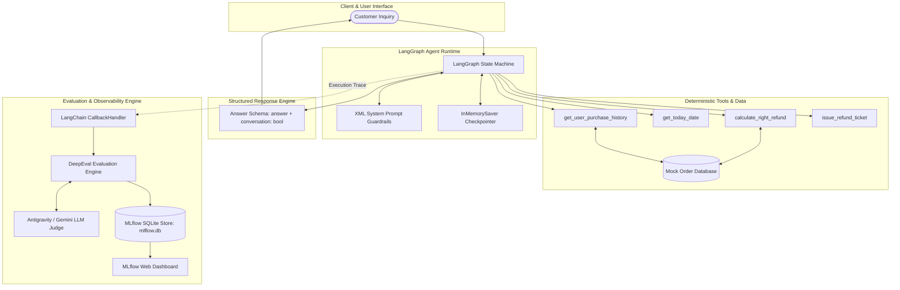
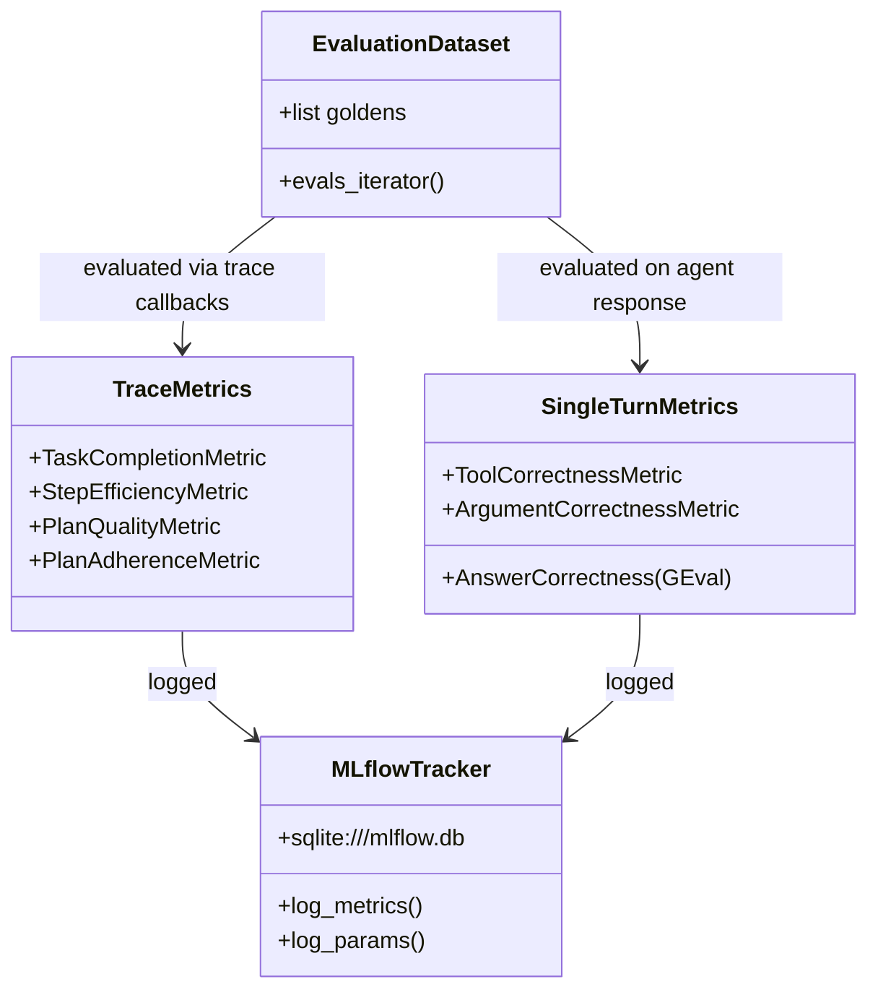

# System Architecture & Technical Specifications

## 1. High-Level System Architecture

The following diagram illustrates the interaction between the customer, the agent runtime, the tool execution layer, and the evaluation/observability pipeline:

---

## 2. Component Specifications

### 2.1 Agent Core (`agent/agent.py`)
* **Framework**: LangChain `create_agent` with LangGraph checkpointer.
* **State Checkpointing**: `InMemorySaver` isolates conversation sessions using unique `thread_id` identifiers.
* **Structured Response Handling**: Every output is returned as an `Answer` object (`answer: str`, `conversation: bool`) to guarantee clean multi-turn control.

### 2.2 Tool Suite (`agent/tools.py`)
Each tool implements typed Pydantic signatures and logging:
1. `get_user_purchase_history(user: str) -> dict`: Looks up user orders in mock data. Returns `{"status": "User Not Found"}` for invalid users.
2. `get_today_date() -> str`: Calls system date (`datetime.date.today()`) formatted as `%Y-%m-%d`. Takes zero arguments to ensure clean API design.
3. `calculate_right_refund(user: str, items: list[PurchaseItem]) -> str`: Case-insensitive, underscore-tolerant pricing calculator that sums verified prices.
4. `issue_refund_ticket(user: str, refund_amount: int) -> str`: Simulates ticket issuance for approved refunds.

### 2.3 Prompt Guardrails (`agent/prompts.py`)
Structured using semantic XML blocks to prevent prompt leakage and enforce deterministic behaviors:
* `<role>`: Establishes agent persona as a meticulous Customer Support Refund Specialist.
* `<policy_rules>`: 30-day window, verified orders only, scope limitation, mandatory tool backing.
* `<workflow>`: Strict sequence: Retrieve History ➔ Check Items ➔ Check Date (if refund requested) ➔ Calculate Refund ➔ Deliver Decision.
* `<communication_standards>`: Deterministic templates for Eligible, Ineligible, and Partially Eligible resolutions.
* `<negative_constraints>`: Hard guardrails preventing premature ticketing, unverified claims, and redundant tool calls.

---

## 3. Evaluation Architecture (`evaluations/`)

The evaluation harness operates at both the **Trajectory Trace level** (using LangChain callbacks) and the **Single-Turn Output level**:

### 3.1 Trace Metrics (Evaluated during agent execution)
* **Task Completion**: Evaluates if the agent fulfilled the task description without exceeding boundaries.
* **Step Efficiency**: Evaluates execution trajectory minimality; strictly docks score if unnecessary tool calls are made.
* **Plan Quality**: Validates that reasoning and planning steps are coherent and adhere to policy.
* **Plan Adherence**: Verifies that the agent executed the exact planned workflow.

### 3.2 Single-Turn Metrics (Evaluated post-execution)
* **Tool Correctness**: Verifies that all expected tools were invoked.
* **Argument Correctness**: Evaluates tool parameters against customer request text for user-derived tools (`get_user_purchase_history`, `calculate_right_refund`).
* **Answer Correctness (GEval)**: LLM-as-a-judge metric verifying that the agent's actual output matches the expected output's logical conclusion.

### 3.3 Experiment Tracking (MLflow)
* Integrated using `mlflow.set_tracking_uri("sqlite:///mlflow.db")`.
* Logs pass rates, total tests passed/failed, and individual metric averages (`avg_task_completion`, `avg_step_efficiency`, etc.).
* Accessible via `mlflow ui --backend-store-uri sqlite:///mlflow.db --port 5000`.
