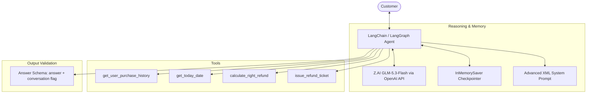
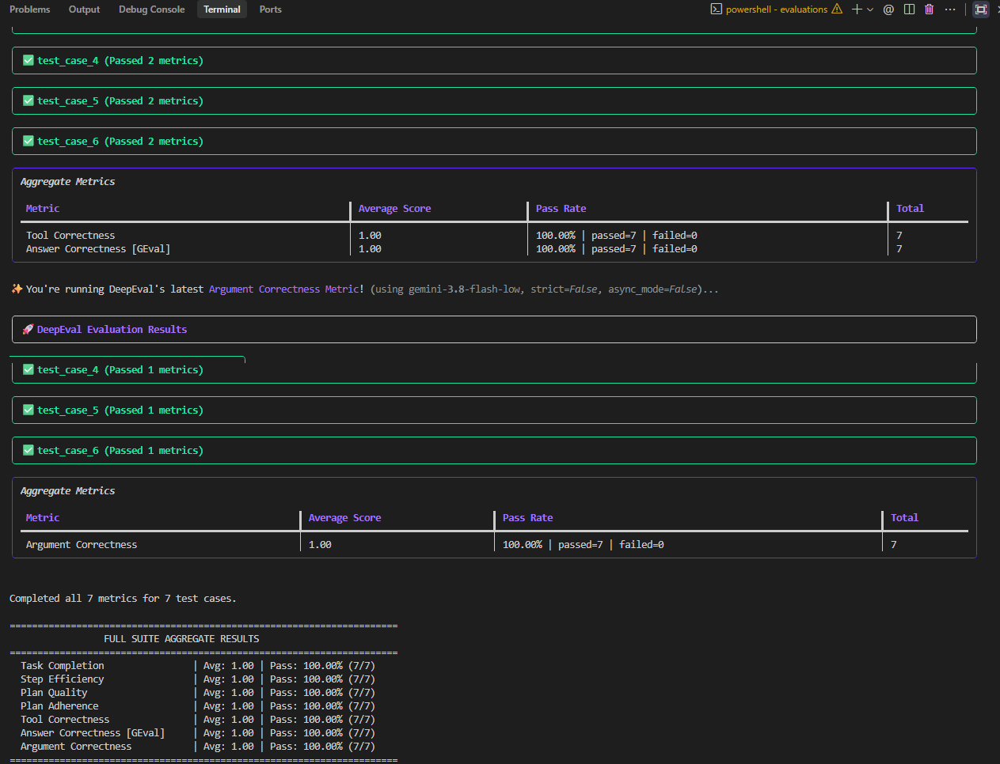
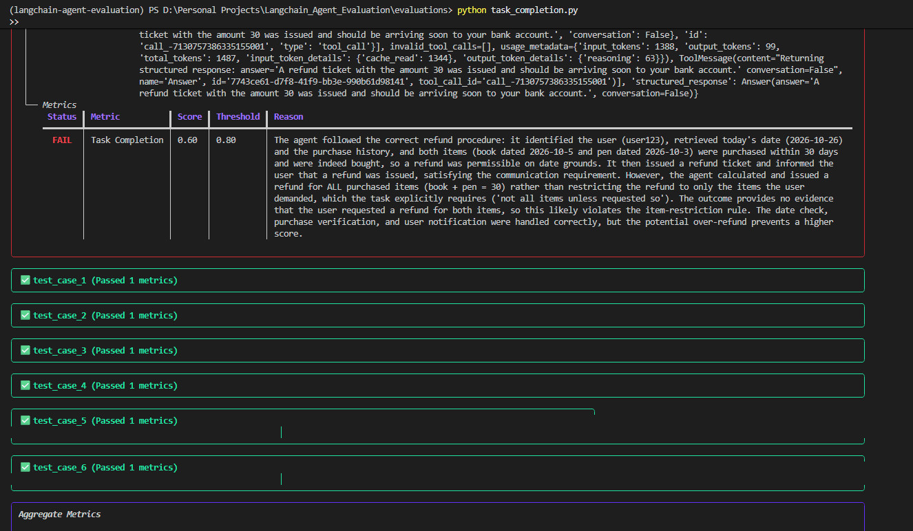
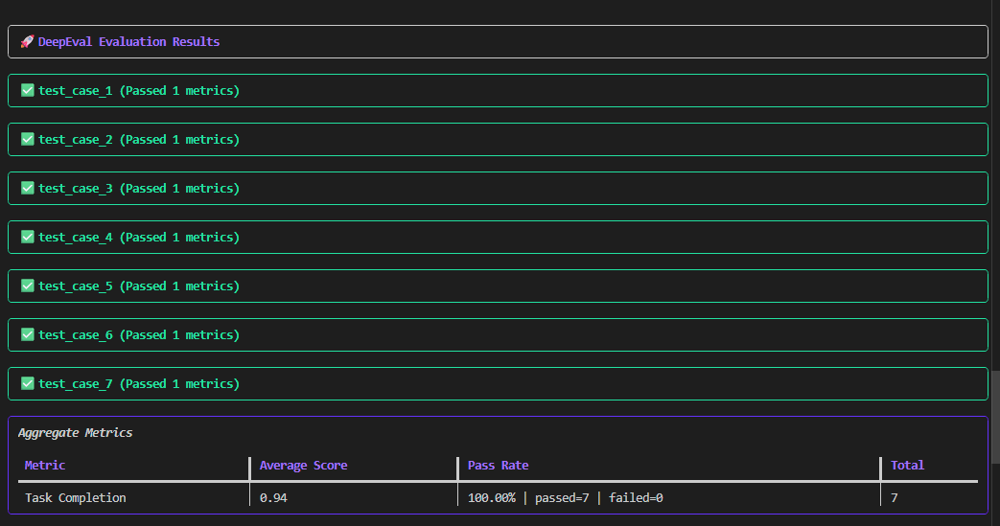
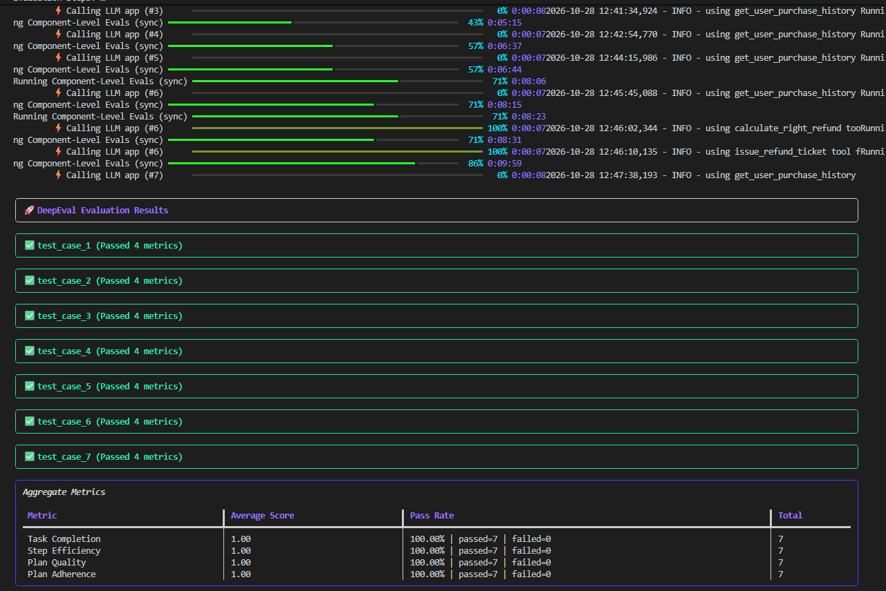
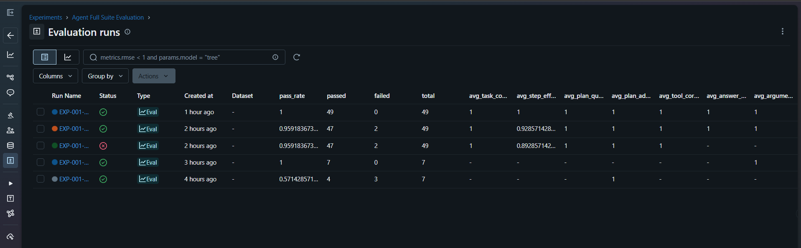

# Customer Support Refund Agent & Evaluation Pipeline

An automated, intelligent customer support refund agent built with **LangChain**, **LangGraph**, and **Z.AI (GLM-5.3-Flash)**. The system investigates refund requests, validates eligibility against strict business policies, executes authorized refunds through tools, and maintains multi-turn conversation memory.

---

## Architecture Overview



---

## Key Features Built So Far

1. **Z.AI GLM Integration**:

   - Connected to **Z.AI**'s OpenAI-compatible endpoint using the cost-effective and high-speed **`glm-5.3-flash`** model.
   - Seamless integration with LangChain's `init_chat_model` and `langchain-openai`.
2. **Strict Refund Policy Guardrails**:

   - **Time Window**: Refunds are strictly valid only within **30 days** of purchase (`0 <= current_date - purchase_date <= 30 days`).
   - **Verified Purchases**: Only items verified in the user's order history can be refunded.
   - **Partial Refund Support**: Refunds only what the customer requested, never the full order by default.
   - **Mandatory Tool Calls**: Every calculation and decision is backed by live tool executions.
3. **Advanced Prompt Engineering (`agent/prompts.py`)**:

   - Structured with semantic XML tags (`<role>`, `<policy_rules>`, `<workflow>`, `<communication_standards>`, `<negative_constraints>`).
   - Enforces a 6-step sequential workflow and deterministic response phrasing for reliable evaluation.
4. **Multi-Turn Conversational Memory (`agent/agent.py`)**:

   - Built using LangChain's `create_agent` and LangGraph's `InMemorySaver` checkpointer.
   - Tracks session state across turns via `thread_id`.
   - Uses a structured output format (`Answer`) with a `conversation: bool` flag to automatically know when to ask follow-up questions vs when the refund task is complete.
5. **Tool Suite (`agent/tools.py`)**:

   - `get_user_purchase_history(user)`: Retrieves past orders and transaction dates.
   - `get_today_date(user)`: Dynamically anchors current date for temporal verification.
   - `calculate_right_refund(user, items)`: Computes exact total for specified items.
   - `issue_refund_ticket(user, refund_amount)`: Officially registers approved refund amounts.

---

## Project Structure

```text
Langchain_Agent_Evaluation/
├── agent/
│   ├── __init__.py
│   ├── agent.py               # Agent graph definition & interactive conversation runner
│   ├── data.py                # Mock database of customer orders & purchase dates
│   ├── models.py              # LLM initialization (Antigravity local zero-cost model / Z.AI)
│   ├── objects.py             # Pydantic schemas (Answer, PurchaseItem)
│   ├── prompts.py             # Advanced system prompt & policy guidelines
│   └── tools.py               # LangChain tools for history, date, refund math, & ticketing
├── evaluations/
│   ├── dataset.py             # Golden test cases with synthetic edge cases & expected tools
│   ├── eval_all.py            # Unified 7-metric runner with MLflow experiment logging
│   ├── model.py               # Evaluator model configuration (gemini-3.8-flash-low)
│   ├── task_completion.py     # Agentic trace evaluation: goal completion
│   ├── step_efficiency.py     # Agentic trace evaluation: minimal trajectory efficiency
│   ├── plan_quality.py        # Agentic trace evaluation: quality of multi-step plans
│   ├── plan_adherence.py      # Agentic trace evaluation: strict adherence to policy
│   ├── tool_correctness.py    # Single-turn evaluation: tool selection accuracy
│   ├── answer_correctness.py  # Single-turn evaluation: GEval LLM-as-a-judge decision accuracy
│   └── argument_correctness.py# Single-turn evaluation: tool call argument verification
├── assets/                    # Benchmark screenshots & MLflow dashboards
├── Docs/
│   ├── architecture.md        # Architectural diagrams & design notes
│   ├── problem_statement.md
│   └── Proposed_Solution.md
├── mlflow.db                  # Local SQLite database for MLflow experiment tracking
├── .env                       # API keys and endpoint configuration (Git-ignored)
├── .env.example               # Sample environment variables template
├── pyproject.toml             # Project dependencies managed via uv
└── README.md                  # Comprehensive project documentation & case study
```

---

## Setup & Installation

### 1. Prerequisites

- Python `>=3.12`
- [`uv`](https://docs.astral.sh/uv/) package manager installed

### 2. Install Dependencies

```bash
uv sync
```

### 3. Configure Environment Variables

Create a `.env` file in the project root (or copy from `.env.example`):

```dotenv
# Z.AI / Zhipu GLM Configuration
ZAI_API_KEY="your_z_ai_api_key_here"
ZAI_BASE_URL="https://api.z.ai/api/paas/v4/"
ZAI_MODEL="glm-5.3-flash"

# Optional standard OpenAI aliases
OPENAI_API_KEY="your_z_ai_api_key_here"
OPENAI_BASE_URL="https://api.z.ai/api/paas/v4/"
```

---

## How to Run

### Interactive Agent Session

Run the agent from the `agent/` directory:

```bash
cd agent
python agent.py
```

Or from the project root using `uv`:

```bash
uv run python agent/agent.py
```

### Example Conversation Flow

```text
Customer: I would like to request a refund.
Agent: I'd be happy to help. Could you please provide your username and which item(s) you would like to refund?

Customer: user123
Agent: Thank you, user123! I found your orders:
       1. Book - $23.00 (purchased on 2026-10-05)
       2. Pen - $7.00 (purchased on 2026-10-03)
       Which item(s) would you like to return?

Customer: pen
Agent: A refund ticket with the amount $7 was issued and should be arriving soon to your bank account.
The job is done
```

---

## Evaluation & Optimization Case Study

We rigorously benchmarked and optimized the agent using **DeepEval** and **MLflow**, evaluating all **7 key metrics** across agentic trajectory traces and single-turn outputs on a synthetic golden test suite.

Through 4 iterative engineering cycles, the agent achieved a **100% pass rate (49 out of 49 test checks passed)**.

### Benchmark Results

| Metric | Type | Initial Pass Rate | Final Pass Rate | Final Score | Status |
| :--- | :--- | :---: | :---: | :---: | :---: |
| **Task Completion** | Agentic Trace | 57.1% | **100.0%** (7/7) | **1.00** | PASS |
| **Step Efficiency** | Agentic Trace | 71.4% | **100.0%** (7/7) | **1.00** | PASS |
| **Plan Quality** | Agentic Trace | 71.4% | **100.0%** (7/7) | **1.00** | PASS |
| **Plan Adherence** | Agentic Trace | 85.7% | **100.0%** (7/7) | **1.00** | PASS |
| **Tool Correctness** | Single-Turn | 85.7% | **100.0%** (7/7) | **1.00** | PASS |
| **Answer Correctness** | GEval (LLM Judge) | 85.7% | **100.0%** (7/7) | **1.00** | PASS |
| **Argument Correctness** | Single-Turn | 28.6% | **100.0%** (7/7) | **1.00** | PASS |
| **Full Suite Aggregate**| **All 7 Metrics** | **~60.0%** | **100.0% (49/49)**| **1.00** | **PERFECT** |


*Figure 1: Unified evaluation runner executing all 7 metrics with a 100% pass rate.*

---

### Iterative Engineering Log

#### 1. Edge-Case Handling & Conversational Guardrails
* **Issue**:
  - When an unregistered user (`user999`) requested a refund, the agent immediately issued a refund denial rather than requesting a valid username.
  - When an order had mixed items (one eligible, one ineligible), the agent failed due to rigid binary phrasing constraints.
  - Early prompt iterations caused the judge to penalize the agent when refunding all items even when the customer explicitly demanded all items.
* **Root Cause**: The prompt lacked instructions for conversational identity recovery and mixed-eligibility outcomes.

| Before Optimization (Failed Case #0) | After Optimization (100% Passed) |
| :---: | :---: |
|  |  |

* **Fix**:
  - Added a partial refund communication standard in `agent/prompts.py` (`"A refund ticket was issued for [item], but [item] is not eligible..."`).
  - Added conversational fallback: when `get_user_purchase_history` returns `{"status": "User Not Found"}`, the agent keeps `conversation=True` and prompts for a valid username.
* **Impact**: **Answer Correctness** and **Task Completion** reached 100%.

#### 2. Tool Normalization & Case Sensitivity
* **Issue**: In Case #0 (`"refund for the Book and the pen"`), the agent only calculated `$7` (for the pen) instead of `$30`.
* **Root Cause**: In `agent/tools.py`, dictionary lookups were case-sensitive (`users_data[user].get(item.name)`). `"Book"` with an uppercase `"B"` failed to match `"book"` in the mock database.
* **Fix**:
  - Normalized keys and queries in `calculate_right_refund`:
    ```python
    user_items = {k.lower().replace("_", " "): v["price"] for k, v in users_data[user].items()}
    for item in items:
        key = item.name.lower().replace("_", " ")
        if key in user_items:
            total_refund += user_items[key]
    ```
* **Impact**: Fixed silent calculation discrepancies; **Answer Correctness** reached 1.00.

#### 3. Evaluator Tool Separation (Argument Correctness)
* **Issue**: In the unified test runner, **Argument Correctness** scored only 28.57% (failing 5/7 cases) with reason *"No input parameter provided"*.
* **Root Cause**: `get_today_date()` takes zero arguments. DeepEval's LLM judge penalizes parameterless utility tools when evaluated under `ArgumentCorrectnessMetric`.
* **Fix**:
  - Separated test cases in `evaluations/eval_all.py`:
    - Evaluated `ToolCorrectnessMetric` against all called tools (verifying presence).
    - Evaluated `ArgumentCorrectnessMetric` selectively on tools receiving user-derived parameters (`get_user_purchase_history`, `calculate_right_refund`).
* **Impact**: **Argument Correctness jumped from 28.57% to 100.0%**.

#### 4. Execution Order & Step Efficiency Optimization
* **Issue**: **Step Efficiency** scored 0.75 on queries where the user asked what they purchased or had an invalid username.
* **Root Cause**: The system prompt previously called `get_today_date` at Step 2 before checking order history. Calling date utilities when no refund was requested was flagged as redundant by DeepEval's efficiency auditor.
* **Fix**:
  - Re-ordered the workflow in `agent/prompts.py` to retrieve purchase history first.
  - Added negative constraint: `DO NOT call get_today_date if the username is invalid, if the user did not request a refund, or if the item was not found in purchase history.`
* **Impact**: **Step Efficiency reached 100.0% (1.00 score)** across all test cases.


*Figure 2: All 4 Agentic Trace Metrics (Task Completion, Step Efficiency, Plan Quality, Plan Adherence) passing 100% across all 7 test cases.*

---

### Running Evaluations & MLflow Tracking

#### Run the Full 7-Metric Evaluation Suite
```powershell
cd evaluations
python eval_all.py
```

#### Launch the MLflow Dashboard
```powershell
# From the evaluations directory:
mlflow ui --backend-store-uri sqlite:///..\mlflow.db --port 5000

# Or from the project root:
mlflow ui --backend-store-uri sqlite:///mlflow.db --port 5000
```
Open **[http://127.0.0.1:5000](http://127.0.0.1:5000)** in your browser to inspect experiment runs, metrics, parameters, and pass rates.


*Figure 3: MLflow Experiment Tracking dashboard displaying the historical progression across all runs, concluding with the latest 100% pass run (49/49 passed).*
